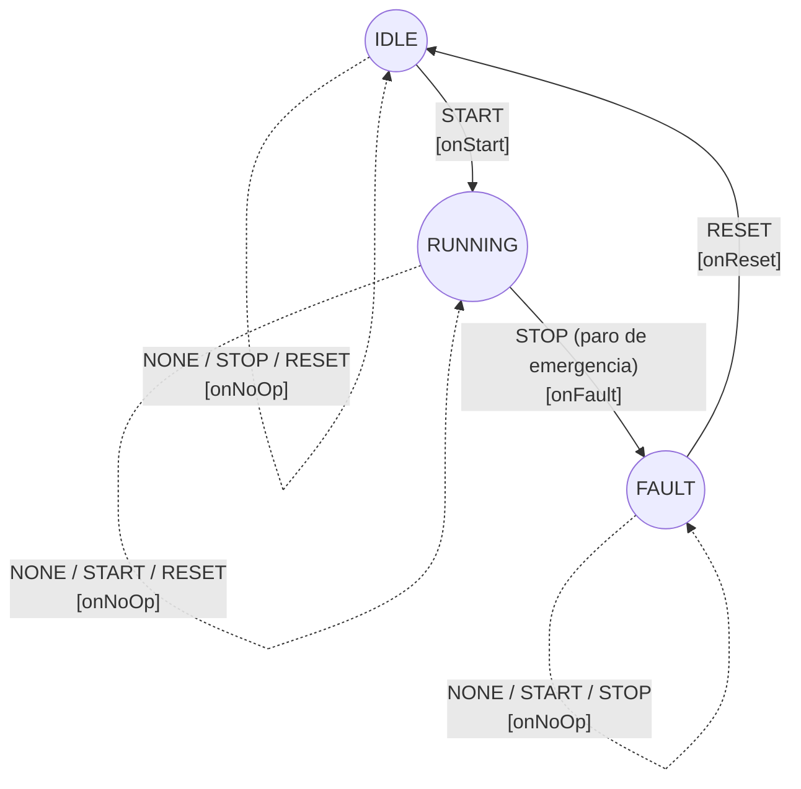
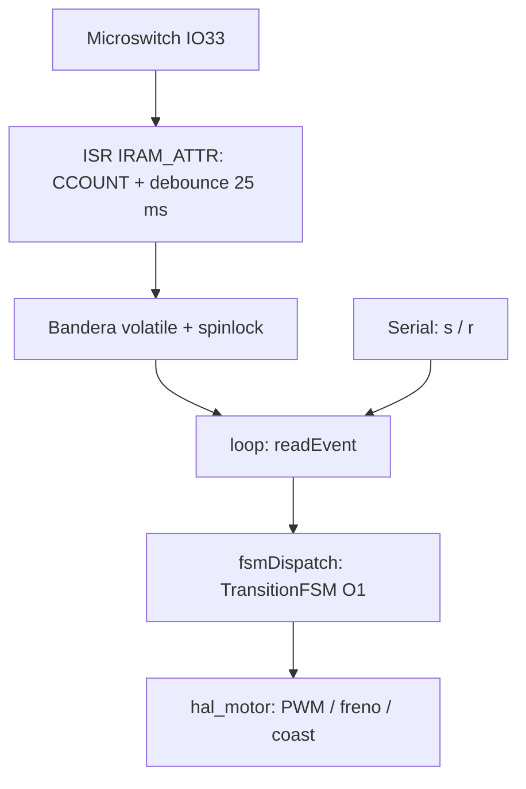

## Matriz de transiciones (Estado x Evento)

| Estado \ Evento | NONE | START | STOP | RESET |
|---|---|---|---|---|
| IDLE | IDLE | RUNNING (onStart) | IDLE | IDLE |
| RUNNING | RUNNING | RUNNING | FAULT (onFault) | RUNNING |
| FAULT | FAULT | FAULT | FAULT | IDLE (onReset) |

## Flujo de datos

